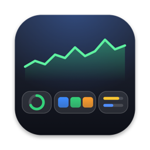
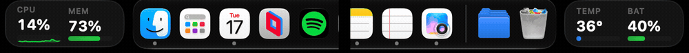
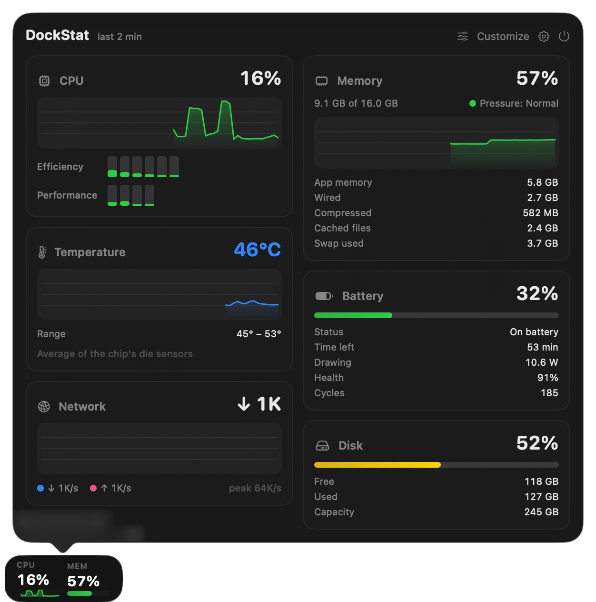
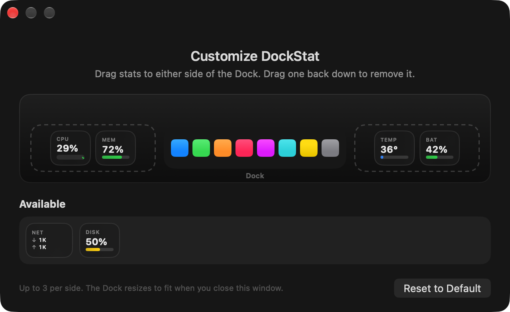
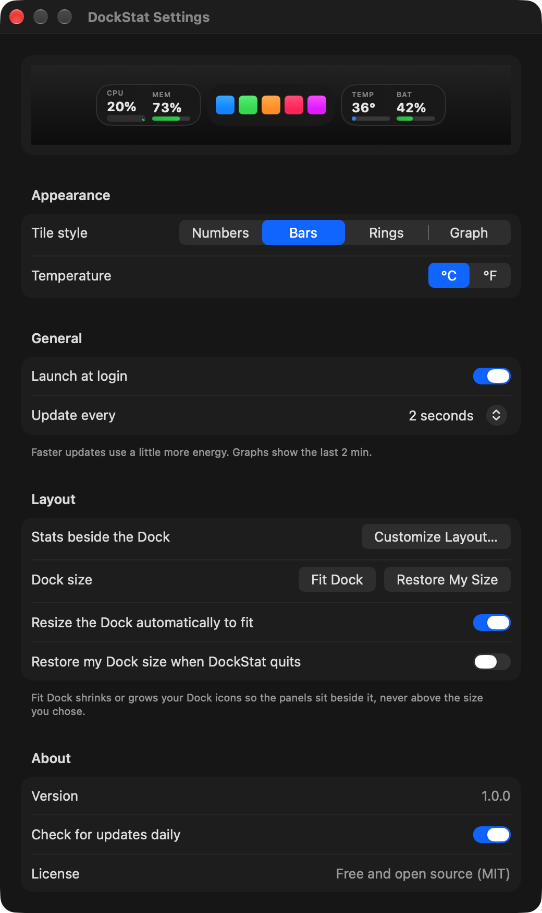
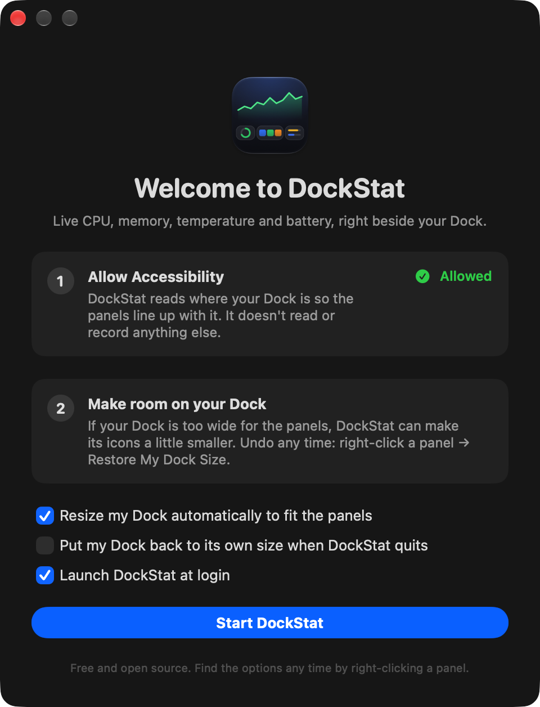
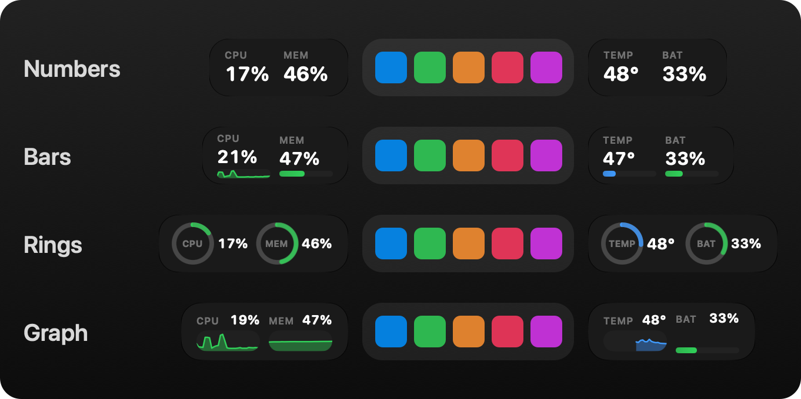

<p align="center">
  
</p>

<h1 align="center">DockStat</h1>

<p align="center">
  <b>Live system stats that sit right beside your Dock.</b><br>
  A free, open-source alternative to iStat Menus for macOS.
</p>

<p align="center">
  
  
  
  
</p>

<p align="center">
  
</p>

---

## Why DockStat?

Menu bar monitors fight for space with every other app, and on MacBooks with a notch they
often disappear behind it. DockStat puts your stats somewhere you already look all day:
**two glass panels on either side of the Dock**, matching its height, corners and Liquid Glass
style, so they look like they came with macOS.

|                         | DockStat | iStat Menus |
|-------------------------|:--------:|:-----------:|
| Price                   | **Free** | Paid        |
| Open source             | ✅       | ❌          |
| Lives beside the Dock   | ✅       | Menu bar    |
| Hidden by the notch     | Never    | Sometimes   |
| CPU, memory, temperature, battery, network, disk | ✅ | ✅ |

## Features

- **Panels beside the Dock** that match its height and style, at the bottom, left or right of the screen.
- **Six stats:** CPU, memory, chip temperature (Apple Silicon), battery, network and disk.
- **Drag-and-drop layout:** choose which stats sit on each side of the Dock (up to 3 per side).
- **Click for details:** 2-minute graphs, per-core CPU (efficiency and performance cores), memory pressure and breakdown, battery health, cycle count and power draw, disk space.
- **Four tile styles:** Numbers, Bars, Rings and Graph. °C or °F.
- **Stays out of the way:** follows an auto-hiding Dock, hides in full-screen apps, and moves with the Dock between displays.
- **Makes room on your Dock** (only if you allow it) and can put it back when you quit.
- **Lightweight:** about **0.8% CPU and 17 MB of memory** on an M4 MacBook Air, updating every 2 seconds.
- Launch at login, VoiceOver labels, and a welcome screen that explains every permission before asking.

## Screenshots

<table>
  <tr>
    <td></td>
    <td></td>
  </tr>
  <tr>
    <td align="center"><b>Click a panel for details</b></td>
    <td align="center"><b>Drag stats to either side of the Dock</b></td>
  </tr>
  <tr>
    <td></td>
    <td></td>
  </tr>
  <tr>
    <td align="center"><b>Four styles, units, refresh rate</b></td>
    <td align="center"><b>Explains permissions on first launch</b></td>
  </tr>
</table>

<p align="center"></p>

## Install

### Download

1. Download `DockStat-x.y.z.zip` from the [latest release](https://github.com/preston100/DockStat/releases/latest).
2. Unzip it and drag **DockStat** into your **Applications** folder.
3. The first time, **right-click DockStat → Open**, then click **Open**. (The app isn't notarized
   by Apple yet, so macOS asks once. If it says the app is damaged, run
   `xattr -dr com.apple.quarantine /Applications/DockStat.app` in Terminal.)

### Build from source (one command)

You only need Apple's free Command Line Tools (`xcode-select --install`), not Xcode.

```bash
git clone https://github.com/preston100/DockStat.git && cd DockStat && ./install.sh
```

This builds DockStat, installs it in `~/Applications` and launches it.

## Using DockStat

| Do this | To |
|---|---|
| **Click** a panel | Open the details (click again to close) |
| **Right-click** a panel | Customize Layout, Settings, Fit Dock, Restore My Dock Size, Quit |
| **Customize Layout…** | Drag stats between the left side, the right side and the tray |
| **Settings…** | Tile style, °C/°F, update rate, launch at login, Dock options |

### Permissions

DockStat asks for **Accessibility** access. It uses it for one thing only: reading where your
Dock is drawn, so the panels line up with it exactly. It doesn't read your windows, typing or
anything else.

### Your Dock size

If your Dock is too wide for the panels, DockStat can make its icons a little smaller. It only does
this if you allow it on the welcome screen (or in Settings), never grows the Dock beyond the size
you chose, and **Restore My Dock Size** puts it back at any time.

## Privacy

No accounts, no analytics, no tracking. The only network request is an optional once-a-day check of
this repo's latest release, so DockStat can tell you about updates. Turn it off in Settings.

## How it works

- **CPU, memory:** Mach host statistics (`host_statistics`, `host_processor_info`), the same numbers Activity Monitor uses.
- **Temperature:** Apple Silicon die sensors through IOKit's HID event system (an undocumented API; not available on Intel Macs).
- **Battery:** IOKit power sources and the `AppleSmartBattery` registry entry.
- **Network, disk:** interface counters from `getifaddrs` and volume capacity from Foundation.
- **Placement:** the Dock's on-screen frame through the Accessibility API, with small corrections measured against what macOS actually draws.
- **Look:** `NSGlassEffectView` (Liquid Glass) on macOS 26+, a frosted blur on macOS 14 and 15.

Sampling happens off the main thread, and only for the stats you show. Detail-only readings (per-core CPU,
memory breakdown, battery health) are only read while the details are open.

## Uninstall

1. Right-click a panel → **Restore My Dock Size** (if DockStat resized it), then **Quit DockStat**.
2. Delete DockStat from your Applications folder.
3. Optional: remove it from **System Settings → Privacy & Security → Accessibility**, and run
   `defaults delete com.preston100.DockStat` to clear its settings.

## Development

```bash
./install.sh --dev        # rebuild + relaunch, keeping the Accessibility permission between builds
Scripts/release.sh        # universal zip for GitHub Releases (see the script for notarization)
Scripts/make-icon.swift   # regenerates the app icon
```

Never share a `--dev` build: it signs the app in a way that lets any app with the same bundle ID
inherit its Accessibility permission. Launch flags for testing and screenshots:
`--welcome`, `--customize`, `--settings`, `--details`, `--fit-dock`, `--debug-log`.

Built and tested on macOS 26 and 27 (Apple Silicon). Reports from macOS 14, 15 and Intel Macs are very welcome.

## License

[MIT](LICENSE). Free to use, change and share.
